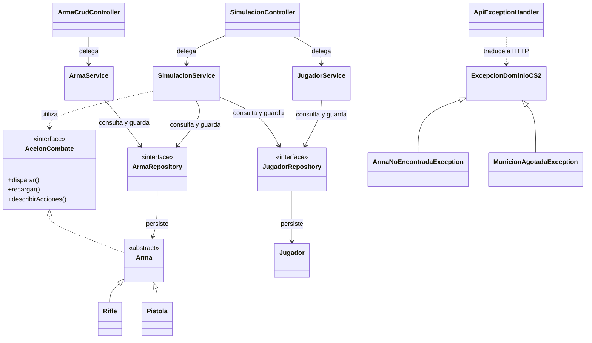

# API REST de armas de Counter-Strike 2

## Objetivo

Este proyecto implementa una API REST con Java 21 y Spring Boot para administrar armas de Counter-Strike 2, persistir su estado en H2 y ejecutar simulaciones de combate. Aplica encapsulamiento, herencia, polimorfismo, interfaces, excepciones de dominio y persistencia con Spring Data JPA.

## Tecnologías

- Java 21
- Spring Boot y Spring Web
- Spring Data JPA
- H2
- Maven
- JUnit 5
- Git y GitHub
- Insomnia
- Mermaid

## Modelo y persistencia

La familia principal está formada por `Arma`, clase padre abstracta, y sus clases hijas `Rifle` y `Pistola`. Se utiliza la estrategia de herencia JPA `SINGLE_TABLE`: las entidades se almacenan en una tabla compartida y se distinguen mediante la columna discriminadora `tipo_arma`.

La clase `Jugador` también se persiste y representa al jugador que recibe daño y mantiene una reserva de munición. `ArmaRepository` administra la familia de armas y `JugadorRepository` administra los jugadores mediante Spring Data JPA.

Los identificadores son gestionados por la persistencia. Se utilizan para consultar, actualizar y eliminar los recursos.

## Organización por capas

El proyecto separa los controladores REST, los servicios y los repositorios.

- `ArmaCrudController` recibe las solicitudes HTTP del CRUD de armas y delega las operaciones en `ArmaService`.
- `ArmaService` valida los datos de entrada y coordina la creación, consulta, actualización y eliminación de armas utilizando `ArmaRepository`.
- `SimulacionController` delega las operaciones de combate en `SimulacionService` y las operaciones de jugadores en `JugadorService`.
- `SimulacionService` coordina las reglas de disparo y recarga, consulta los recursos necesarios y persiste los cambios de la simulación.
- `JugadorService` centraliza la creación y consulta de jugadores mediante `JugadorRepository`.
- Los servicios de demostración separan las operaciones didácticas de la lógica de los controladores.

Los controladores no acceden directamente a los repositorios. La validación de las solicitudes y la coordinación de las operaciones se realizan en los servicios correspondientes.

## Reglas de negocio

1. **Daño y disparo:** durante la simulación, `SimulacionService` calcula el daño efectivo según el daño base, la distancia y la precisión del rifle. El disparo consume una bala y reduce la vida del jugador. Los cambios se guardan en H2.
2. **Recarga:** la recarga completa el cargador utilizando la reserva de munición del jugador. La operación verifica que haya reserva suficiente y persiste los cambios del arma y del jugador.

Estas operaciones se coordinan mediante servicios y transacciones para mantener coherentes los cambios de los recursos implicados.

La actualización de un arma mediante PUT conserva la munición actual cuando sigue siendo compatible con la capacidad del cargador actualizado. Por ejemplo, si un rifle tenía 29 balas de un máximo de 30, cambiar su nombre y precio no debe reiniciar automáticamente la munición a 30.

## Interfaz de dominio

`AccionCombate` define las operaciones comunes de combate: disparar, recargar y describir acciones. `Arma` implementa esta interfaz, y `Rifle` y `Pistola` heredan su contrato y proporcionan el comportamiento específico de sus subtipos.

El endpoint `GET /api/simulacion/acciones/{armaId}` consulta las acciones disponibles mediante la interfaz.

## Endpoints REST

La dirección base de la aplicación es `http://localhost:8080`.

### CRUD de armas

| Método | Ruta | Propósito |
|---|---|---|
| POST | `/api/armas` | Crear un arma. |
| GET | `/api/armas` | Listar armas. |
| GET | `/api/armas/{id}` | Consultar un arma por ID. |
| PUT | `/api/armas/{id}` | Actualizar un arma existente. |
| DELETE | `/api/armas/{id}` | Eliminar un arma. |

El CRUD persistente admite rifles y pistolas.

Ejemplo de cuerpo para crear un rifle:

```json
{
  "tipo": "rifle",
  "nombre": "AK-47 SIMULACION",
  "precio": 2700,
  "dano": 36,
  "cargador": 30
}
```

La API valida los datos recibidos. Entre otras condiciones, rechaza nombres vacíos, valores no válidos, cargadores inválidos, tipos no admitidos y datos numéricos incorrectos.

Respuestas principales del CRUD:

- HTTP 201: recurso creado.
- HTTP 200: consulta o actualización exitosa.
- HTTP 204: eliminación exitosa sin cuerpo de respuesta.
- HTTP 400: datos de entrada inválidos.
- HTTP 404: arma inexistente.

### Jugadores y simulación

| Método | Ruta | Propósito |
|---|---|---|
| POST | `/api/simulacion/jugadores` | Crear un jugador persistido. |
| GET | `/api/simulacion/jugadores/{id}` | Consultar un jugador. |
| GET | `/api/simulacion/acciones/{armaId}` | Consultar las acciones del arma. |
| POST | `/api/simulacion/disparar?rifleId={id}&jugadorId={id}&distancia={valor}` | Disparar un rifle contra un jugador. |
| POST | `/api/simulacion/recargar?armaId={id}&jugadorId={id}` | Recargar usando la reserva del jugador. |
| POST | `/api/simulacion/acciones/{armaId}/recargar?jugadorId={id}` | Ejecutar la recarga mediante el servicio de acciones. |

Ejemplo para crear un jugador:

```json
{
  "nombre": "Jugador prueba",
  "vida": 100,
  "municionReserva": 90
}
```

Primero se debe crear el arma y el jugador, y guardar los identificadores que devuelven las respuestas. Después se pueden realizar las operaciones de simulación y consultar nuevamente el estado para verificar la persistencia.

## Excepciones y respuestas HTTP

La jerarquía de excepciones contiene una clase base, `ExcepcionDominioCS2`, y dos clases específicas:

- `ArmaNoEncontradaException`: representa un arma inexistente y se traduce en HTTP 404.
- `MunicionAgotadaException`: representa una operación que no puede realizarse por falta de munición y se traduce en HTTP 409.

`ApiExceptionHandler` centraliza la traducción de excepciones a respuestas HTTP. Los argumentos inválidos y las solicitudes con datos incorrectos se responden con HTTP 400.

## Configuración de H2

La configuración se encuentra en `src/main/resources/application.properties`.

| Propiedad | Función |
|---|---|
| `spring.datasource.url=jdbc:h2:file:./data/cs2db;DB_CLOSE_ON_EXIT=FALSE` | Guarda la base de datos en archivos dentro de `data/`. |
| `spring.datasource.driver-class-name=org.h2.Driver` | Selecciona el controlador JDBC de H2. |
| `spring.datasource.username=sa` | Define el usuario local. |
| `spring.datasource.password=` | Utiliza una contraseña vacía en esta configuración de desarrollo. |
| `spring.jpa.hibernate.ddl-auto=update` | Actualiza el esquema según las entidades. |
| `spring.jpa.show-sql=true` | Muestra las consultas SQL en los registros. |
| `spring.jpa.open-in-view=false` | Desactiva Open EntityManager in View. |
| `spring.h2.console.enabled=true` | Habilita la consola web de H2. |
| `spring.h2.console.path=/h2-console` | Define la ruta de la consola. |

La consola H2 está disponible en:

`http://localhost:8080/h2-console`

Los datos de conexión son:

- **JDBC URL:** `jdbc:h2:file:./data/cs2db;DB_CLOSE_ON_EXIT=FALSE`
- **Usuario:** `sa`
- **Contraseña:** vacía

El proyecto incluye el módulo de Spring Boot necesario para habilitar la consola H2. Esta configuración está destinada al desarrollo local.

El directorio `data/` está excluido de Git mediante `.gitignore`, porque contiene los archivos de la base de datos local.

## Sobrecarga y sobreescritura

### Sobrecarga (overloading)

La sobrecarga consiste en declarar métodos o constructores con el mismo nombre y diferentes listas de parámetros.

En `Rifle` existen los constructores `Rifle(String nombre, float precio)` y `Rifle(String nombre, float precio, int dano, int cargador)`. El primero delega en el segundo utilizando valores predeterminados.

En `Pistola` también existen constructores con diferentes listas de parámetros.

Ambas clases disponen de los métodos `disparar()` y `disparar(int distancia)`. El primer método permite disparar sin especificar una distancia; el segundo recibe una distancia explícita. Como las listas de parámetros son diferentes, se trata de sobrecarga.

Las validaciones de las solicitudes HTTP se centralizan en los servicios. Los constructores sin argumentos tienen visibilidad `protected` para permitir que JPA reconstruya las entidades sin ofrecerlos como constructores normales de negocio.

### Sobreescritura (overriding)

La clase abstracta `Arma` declara `public abstract String disparar()`. Las clases `Rifle` y `Pistola` implementan el método con la misma firma y utilizan `@Override`.

Cada clase hija proporciona su implementación específica. `Rifle.disparar()` delega en `disparar(100)`, mientras que `Pistola.disparar()` utiliza el comportamiento específico de la pistola.

La sobrecarga utiliza diferentes listas de parámetros; la sobreescritura redefine en una clase hija un método heredado con la misma firma. Cuando una referencia de tipo `Arma` apunta a un rifle o una pistola, Java ejecuta la implementación correspondiente al objeto concreto.

## Respuestas a las preguntas de diseño

**Recurso y verbo HTTP.** El sustantivo principal de la API es el arma y la colección es `/api/armas`; POST crea, GET consulta, PUT actualiza y DELETE elimina los recursos.

**Identidad.** El campo `id` es la clave primaria y JPA lo genera mediante `GenerationType.IDENTITY`. El cliente omite el ID al crear un recurso y utiliza el valor devuelto para las operaciones posteriores.

**Herencia, tablas y tipo de arma.** `Arma` es abstracta y `Rifle` y `Pistola` son sus clases hijas. Se utiliza `SINGLE_TABLE` para guardar la familia en una tabla compartida y distinguir los tipos mediante la columna `tipo_arma`. Al crear un arma, el JSON incluye `tipo` con valor `rifle` o `pistola`, y el servicio construye la clase concreta correspondiente.

**Interfaz y repositorio.** `ArmaRepository` extiende `JpaRepository<Arma, Long>`, de modo que Spring Data JPA proporciona las operaciones comunes. El controlador CRUD depende de `ArmaService`, y este servicio utiliza el repositorio. Así se separan la entrada HTTP, la lógica de negocio y la persistencia.

**Protocolo del dominio.** `AccionCombate` declara `disparar()`, `recargar()` y `describirAcciones()`. `Arma` implementa el contrato y sus subtipos proporcionan el comportamiento heredado o específico. El endpoint `GET /api/simulacion/acciones/{armaId}` permite consultar las acciones disponibles.

**Encapsulamiento e invariantes.** Los atributos del dominio son privados y no se exponen mediante setters públicos. La validación de las solicitudes se centraliza en los servicios. Para comprobar que un POST inválido no agrega datos, se consulta la colección con `GET /api/armas`, se envía un POST inválido y se vuelve a consultar para confirmar que la cantidad de armas persistidas no aumentó.

**PUT y PATCH.** La API usa PUT para actualizar un arma existente. La actualización modifica los atributos permitidos del recurso y conserva la munición actual siempre que sea compatible con la capacidad del cargador. No se ofrece un endpoint PATCH independiente.

**DELETE.** `DELETE /api/armas/{id}` elimina el registro mediante el servicio de armas y devuelve HTTP 204. Si el arma no existe, se responde con HTTP 404.

**Simulación persistida.** `SimulacionService` coordina el disparo o la recarga, consulta los recursos necesarios y persiste el arma y el jugador modificados. Un GET posterior permite comprobar que el nuevo estado quedó guardado en H2.

**Excepciones y JSON de error.** `ExcepcionDominioCS2` es la clase base. `ArmaNoEncontradaException` representa un arma inexistente y devuelve HTTP 404; `MunicionAgotadaException` representa la falta de munición y devuelve HTTP 409. `ApiExceptionHandler`, mediante `@RestControllerAdvice`, traduce las excepciones a respuestas JSON con la clave `error` y el mensaje correspondiente.

## Diagrama de clases



## Cómo ejecutar y probar

### Requisitos

- Java 21.
- Git.
- Insomnia para ejecutar las solicitudes HTTP.

### Arrancar la aplicación

Desde la raíz del repositorio, en Windows PowerShell:

```powershell
.\mvnw.cmd spring-boot:run
```

En Linux o macOS:

```bash
./mvnw spring-boot:run
```

La aplicación queda disponible en `http://localhost:8080`.

Para ejecutar las pruebas automatizadas desde otra terminal:

```powershell
.\mvnw.cmd test
```

En Linux o macOS:

```bash
./mvnw test
```

### Importar Insomnia

1. Abrir Insomnia.
2. Seleccionar la opción para importar datos.
3. Importar `insomnia/CS2-API-2026.json` desde la raíz del repositorio.
4. Configurar `base_url` con el valor `http://localhost:8080`.
5. Crear primero el arma y el jugador, y guardar los IDs que devuelvan las respuestas para utilizarlos en las solicitudes siguientes.

La colección incluye la solicitud `GET /`, que permite comprobar que el servicio está disponible y responde:

`API de armas de Counter-Strike 2 funcionando`

### Orden recomendado de pruebas

1. Ejecutar `GET /` para comprobar que el servicio está disponible.
2. Ejecutar `POST /api/armas` con datos válidos y guardar el ID devuelto.
3. Ejecutar `GET /api/armas` y `GET /api/armas/{id}` para confirmar que el arma creada se encuentra persistida.
4. Ejecutar `PUT /api/armas/{id}` y consultar otra vez para comprobar que el cambio se guardó y que se conservó la munición actual.
5. Enviar un POST inválido, por ejemplo con el nombre vacío. Debe responder HTTP 400 y la colección debe conservar la misma cantidad de armas.
6. Crear un jugador mediante `POST /api/simulacion/jugadores` y guardar su ID.
7. Ejecutar `GET /api/simulacion/acciones/{armaId}` para probar el endpoint que utiliza `AccionCombate`.
8. Ejecutar un disparo usando `/api/simulacion/disparar` y consultar de nuevo el arma y el jugador para comprobar los cambios persistidos en la munición y en la vida.
9. Ejecutar una recarga usando `/api/simulacion/recargar` y consultar de nuevo el arma y el jugador para comprobar los cambios en el cargador y en la reserva.
10. Consultar un ID inexistente, por ejemplo mediante `GET /api/armas/999999`, y comprobar HTTP 404.
11. Agotar la munición de un rifle de prueba e intentar disparar otra vez. Comprobar que la respuesta es HTTP 409 y que el disparo fallido no cambia la vida ni la munición.
12. Ejecutar `DELETE /api/armas/{id}` sobre un recurso de prueba y consultar luego el mismo ID para comprobar que ya no existe.

Las pruebas de simulación deben utilizar IDs reales y un estado del arma preparado para cada caso. La colección está versionada en `insomnia/CS2-API-2026.json`.

### Consultar la base H2

Abrir `http://localhost:8080/h2-console` y conectarse con la URL JDBC:

`jdbc:h2:file:./data/cs2db;DB_CLOSE_ON_EXIT=FALSE`

El usuario es `sa` y la contraseña está vacía, de acuerdo con la configuración local del proyecto.

Las propiedades están en `src/main/resources/application.properties`. El directorio `data/` está excluido de Git para no versionar la base local.

## Commit de implementación

El siguiente enlace identifica el commit que contiene los cambios de código, los servicios y las pruebas automatizadas:

https://github.com/GioMonteggia/SMONTEGGIA-taller-git-2026/commit/5861daf

El enlace que se entregue en Classroom debe apuntar al commit final publicado que incluya las correcciones documentales.

Repositorio: https://github.com/GioMonteggia/SMONTEGGIA-taller-git-2026
