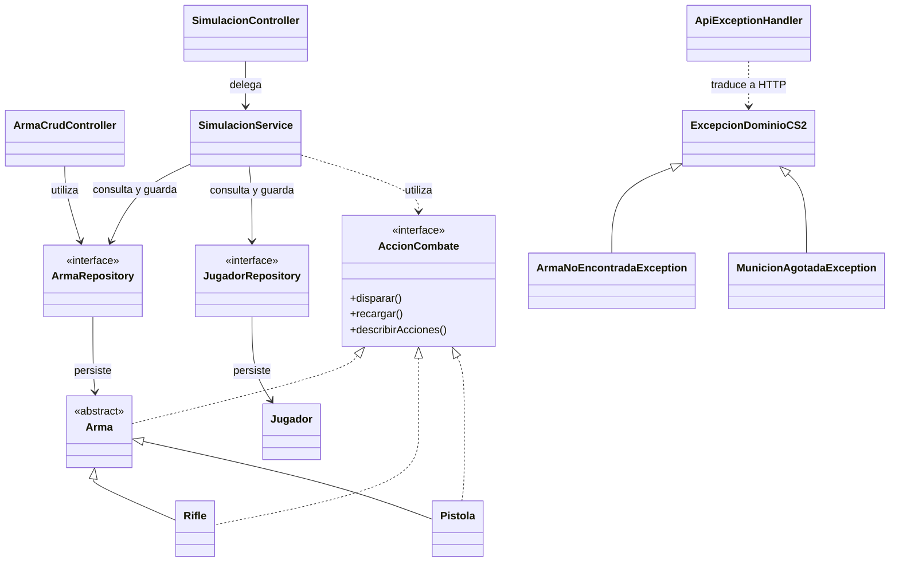

# API REST de armas de Counter-Strike 2

## Objetivo

Este proyecto implementa una API REST con Java 21 y Spring Boot para administrar armas de Counter-Strike 2, persistir su estado en H2 y ejecutar simulaciones de combate. Aplica encapsulamiento, herencia, polimorfismo, interfaces, excepciones de dominio y persistencia con Spring Data JPA.

## Tecnologías

- Java 21
- Spring Boot y Spring Web
- Spring Data JPA
- H2
- Maven
- JUnit 5
- Git y GitHub
- Insomnia
- Mermaid

## Modelo y persistencia

La familia principal está formada por `Arma`, clase padre abstracta, y sus clases hijas `Rifle` y `Pistola`. Las tres son entidades JPA y utilizan herencia `SINGLE_TABLE`: se guardan en una tabla compartida y se distinguen mediante un discriminador. `Rifle` utiliza `RIFLE` y `Pistola`, `PISTOLA`.

La clase `Jugador` también se persiste y representa al jugador que recibe daño y mantiene una reserva de munición. `ArmaRepository` administra la familia de armas y `JugadorRepository` administra los jugadores mediante Spring Data JPA.

Los identificadores son gestionados por la persistencia y se utilizan para consultar, actualizar o eliminar recursos.

## Reglas de negocio

1. **Daño y disparo:** el daño efectivo de un rifle depende del daño base, la distancia y la precisión. Cada disparo válido consume una unidad de munición. Un arma sin munición no puede disparar.
2. **Recarga:** recargar llena el cargador utilizando la reserva de munición del jugador. La operación actualiza el arma y el jugador, y no puede completarse si la reserva es insuficiente.

Estas operaciones se coordinan mediante `SimulacionService` y los cambios se guardan en H2.

## Interfaz de dominio

`AccionCombate` define operaciones de combate: disparar, recargar y describir acciones. `Arma` implementa esta interfaz, y `Rifle` y `Pistola` proporcionan el comportamiento específico de sus subtipos.

El endpoint `GET /api/simulacion/acciones/{armaId}` consulta las acciones disponibles mediante la interfaz.

## Endpoints REST

La dirección base es `http://localhost:8080`.

### CRUD de armas

| Método | Ruta | Propósito |
|---|---|---|
| POST | `/api/armas` | Crear un arma. |
| GET | `/api/armas` | Listar armas. |
| GET | `/api/armas/{id}` | Consultar un arma por ID. |
| PUT | `/api/armas/{id}` | Actualizar un arma existente. |
| DELETE | `/api/armas/{id}` | Eliminar un arma. |

Ejemplo de cuerpo para crear un rifle:

```json
{
  "tipo": "rifle",
  "nombre": "AK-47 SIMULACION",
  "precio": 2700,
  "dano": 36,
  "cargador": 30
}
```

La API valida los datos recibidos. Por ejemplo, rechaza nombres vacíos, valores negativos, cargadores inválidos, tipos no admitidos y datos numéricos incorrectos.

Respuestas principales del CRUD: creación exitosa, HTTP 201; consulta exitosa, HTTP 200; eliminación exitosa, HTTP 204; arma inexistente, HTTP 404; datos inválidos, HTTP 400.

### Jugadores y simulación

| Método | Ruta | Propósito |
|---|---|---|
| POST | `/api/simulacion/jugadores` | Crear un jugador persistido. |
| GET | `/api/simulacion/jugadores/{id}` | Consultar un jugador. |
| GET | `/api/simulacion/acciones/{armaId}` | Consultar las acciones del arma. |
| POST | `/api/simulacion/disparar?rifleId={id}&jugadorId={id}&distancia={valor}` | Disparar un rifle contra un jugador. |
| POST | `/api/simulacion/recargar?armaId={id}&jugadorId={id}` | Recargar usando la reserva del jugador. |
| POST | `/api/simulacion/acciones/{armaId}/recargar?jugadorId={id}` | Ejecutar la recarga a través del servicio. |

Ejemplo para crear un jugador:

```json
{
  "nombre": "Jugador prueba",
  "vida": 100,
  "municionReserva": 90
}
```

Primero se debe crear el arma y el jugador, y luego utilizar los IDs devueltos en las solicitudes de simulación. Después de disparar o recargar, se puede consultar nuevamente el estado para verificar la persistencia.

## Excepciones y respuestas HTTP

La jerarquía de excepciones contiene una clase base, `ExcepcionDominioCS2`, y dos clases específicas:

- `ArmaNoEncontradaException`: representa un arma inexistente y se traduce en HTTP 404.
- `MunicionAgotadaException`: representa una operación que no puede realizarse por falta de munición y se traduce en HTTP 409.

`ApiExceptionHandler` centraliza la traducción de excepciones a respuestas HTTP. Las excepciones generales de dominio y los argumentos inválidos se responden con HTTP 400.

## Configuración de H2

La configuración está en `src/main/resources/application.properties`.

| Propiedad | Función |
|---|---|
| `spring.datasource.url=jdbc:h2:file:./data/cs2db;DB_CLOSE_ON_EXIT=FALSE` | Guarda la base de datos en archivos dentro de `data/`. |
| `spring.datasource.driver-class-name=org.h2.Driver` | Selecciona el controlador JDBC de H2. |
| `spring.datasource.username=sa` | Define el usuario local. |
| `spring.datasource.password=` | Utiliza una contraseña vacía en esta configuración de desarrollo. |
| `spring.jpa.hibernate.ddl-auto=update` | Actualiza el esquema según las entidades. |
| `spring.jpa.show-sql=true` | Muestra las consultas SQL en los registros. |
| `spring.jpa.open-in-view=false` | Desactiva Open EntityManager in View. |
| `spring.h2.console.enabled=true` | Habilita la consola web de H2. |
| `spring.h2.console.path=/h2-console` | Define la ruta de la consola. |

Para abrir la consola, visitar `http://localhost:8080/h2-console` y utilizar la URL JDBC `jdbc:h2:file:./data/cs2db`, el usuario `sa` y la contraseña vacía. Esta configuración es para desarrollo local.

El directorio `/data/` está excluido de Git mediante `.gitignore`, porque contiene los archivos de la base de datos local.

## Sobrecarga y sobreescritura

**Sobrecarga (overloading):** permite definir métodos o constructores con el mismo nombre y diferentes listas de parámetros. Se identifica comparando la cantidad, el tipo o el orden de los parámetros.

**Sobreescritura (overriding):** permite que una clase hija redefina un método heredado conservando su firma, para ofrecer el comportamiento correspondiente a su subtipo. No debe confundirse con la sobrecarga.

## Decisiones de diseño

- **Recursos REST:** las rutas representan recursos y los verbos HTTP expresan las operaciones.
- **Identificadores:** se asignan al persistir los recursos y permiten acceder a ellos posteriormente.
- **Herencia y persistencia:** `SINGLE_TABLE` guarda la familia de armas en una tabla compartida y distingue los subtipos mediante un discriminador.
- **Interfaz:** `AccionCombate` establece un contrato de comportamiento y permite trabajar con distintos tipos de armas.
- **Repositorios:** `ArmaRepository` y `JugadorRepository` separan las operaciones de persistencia de la lógica de negocio.
- **Validaciones:** los datos inválidos se rechazan antes de aceptar la creación o actualización del recurso.
- **PUT y PATCH:** el endpoint PUT representa una actualización del recurso con sus datos requeridos, no una modificación parcial.
- **DELETE:** una eliminación exitosa responde HTTP 204.
- **Reglas de juego:** disparar consume munición y aplica daño; recargar utiliza la reserva del jugador y modifica el cargador.
- **Excepciones:** los casos de arma inexistente y falta de munición tienen excepciones específicas y respuestas HTTP diferenciadas.

## Diagrama de clases



## Cómo ejecutar y probar

1. Requiere Java 21.
2. Desde la raíz del proyecto, ejecutar `.\mvnw.cmd spring-boot:run` en Windows PowerShell.
3. Para ejecutar las pruebas automatizadas, ejecutar `.\mvnw.cmd test`.
4. Importar en Insomnia el archivo `insomnia/CS2-API-2026.json`.
5. Utilizar `http://localhost:8080` como URL base.
6. Crear un arma y un jugador, y utilizar sus IDs en las solicitudes de simulación.
7. Consultar nuevamente los recursos para verificar que los cambios quedaron persistidos.
8. Ejecutar las solicitudes de validación, recurso inexistente y falta de munición para comprobar las respuestas HTTP.

Colección de Insomnia: `insomnia/CS2-API-2026.json`.

## Commit de entrega

Pendiente de completar con el enlace al commit final de la solución.

Repositorio: https://github.com/GioMonteggia/SMONTEGGIA-taller-git-2026
