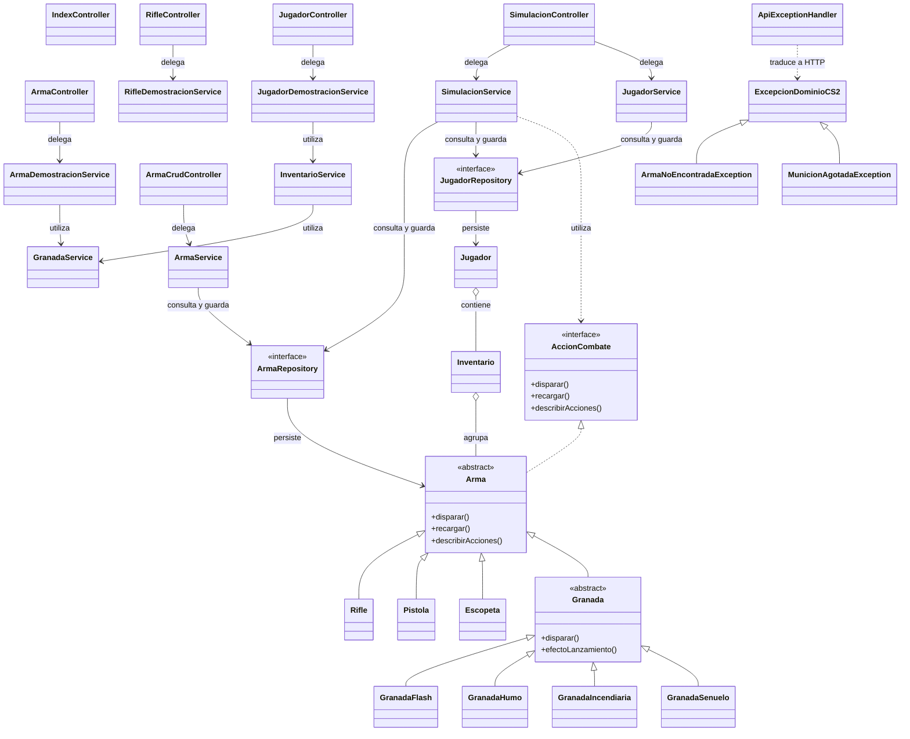

# API REST de armas de Counter-Strike 2

## Objetivo

Este proyecto implementa una API REST con Java 21 y Spring Boot para administrar armas de Counter-Strike 2, persistir su estado en H2 y ejecutar simulaciones de combate. El proyecto demuestra encapsulamiento, herencia, polimorfismo, sobrecarga, sobreescritura, interfaces, excepciones de dominio, servicios y persistencia con Spring Data JPA.

## Tecnologías

- Java 21
- Spring Boot 4.1.1
- Spring Web MVC
- Spring Data JPA
- H2 y consola web H2
- Maven
- JUnit 5
- Git y GitHub
- Insomnia
- Mermaid
- Licencia Apache 2.0

## Modelo y persistencia

La familia principal de armas persistidas está formada por `Arma`, una clase abstracta, y sus clases hijas `Rifle` y `Pistola`. Se utiliza la estrategia de herencia JPA `SINGLE_TABLE`: las entidades de esta familia se guardan en una tabla compartida y se distinguen mediante la columna discriminadora `tipo_arma`.

Los valores de discriminación de las entidades persistidas son `RIFLE` y `PISTOLA`.

La clase `Jugador` también se persiste en la tabla `jugadores_cs2`. Representa al jugador que recibe daño y mantiene una reserva de munición.

El inventario de demostración de `Jugador` está marcado con `@Transient`, por lo que no se persiste como parte de la entidad JPA. Las operaciones del inventario didáctico trabajan con objetos creados para las demostraciones.

Los identificadores son gestionados por JPA y se utilizan para consultar, actualizar y eliminar recursos persistidos.

## Organización por capas

El proyecto separa los controladores REST, los servicios y los repositorios.

- `ArmaCrudController` recibe las solicitudes HTTP del CRUD persistente y delega las operaciones en `ArmaService`.
- `ArmaService` valida los datos y coordina la creación, consulta, actualización y eliminación de armas mediante `ArmaRepository`.
- `SimulacionController` delega las operaciones de combate en `SimulacionService` y las operaciones de jugadores en `JugadorService`.
- `SimulacionService` comprueba las condiciones de la simulación, calcula el daño, coordina los disparos y las recargas y persiste los cambios.
- `JugadorService` valida y crea jugadores, y permite consultarlos mediante `JugadorRepository`.
- `ArmaDemostracionService`, `RifleDemostracionService` y `JugadorDemostracionService` organizan las operaciones didácticas de POO.
- `InventarioService` centraliza las operaciones del inventario de demostración.
- `GranadaService` gestiona el lanzamiento de granadas y su intervalo de reutilización.

Los controladores de las operaciones de armas, jugadores y simulación delegan el trabajo en los servicios correspondientes. Los servicios utilizan los repositorios cuando necesitan consultar o modificar datos persistidos.

## Reglas de negocio

### Disparo

`SimulacionService` comprueba que la distancia sea válida, que el arma exista, que sea un rifle y que tenga munición disponible. También verifica que exista el jugador objetivo antes de completar la simulación.

El daño efectivo depende del daño base, la distancia y la precisión del rifle. Se utiliza el siguiente factor de distancia:

```java
Math.max(0.5f, 1f - distancia / 100f)
```

El daño se calcula redondeando el producto del daño base, el factor de distancia y la precisión.

Por ejemplo, con un rifle de daño base 36, precisión 0,85 y distancia de 50 metros, el daño efectivo es 15 puntos. El servicio consume una bala, reduce la vida del jugador sin dejarla por debajo de cero y persiste los estados modificados.

### Recarga

`SimulacionService` calcula cuántas balas necesita el cargador para alcanzar su capacidad máxima. La operación utiliza la reserva del jugador y guarda tanto el arma como el jugador.

- Si el cargador está lleno, la operación se rechaza con HTTP 400.
- Si no queda munición en el arma al intentar disparar, la operación se rechaza con HTTP 409.
- Si la reserva del jugador es insuficiente para completar una recarga, se rechaza la operación.
- Una recarga correcta resta de la reserva la cantidad necesaria y restaura la munición del cargador.

Estas comprobaciones y la coordinación de los cambios persistidos se encuentran en la capa de servicios. Los métodos del dominio realizan las modificaciones de estado que corresponden a las acciones solicitadas.

### Actualización mediante PUT

El endpoint PUT actualiza un arma existente sin cambiar su subtipo. La actualización conserva la munición actual si sigue siendo compatible con la capacidad del cargador.

Por ejemplo, si un rifle tiene 29 balas de una capacidad máxima de 30, cambiar su nombre y su precio no debe reiniciar la munición a 30. Si se reduce la capacidad máxima por debajo de la munición existente, la cantidad actual se ajusta al nuevo máximo.

## Interfaz de dominio

`AccionCombate` define las operaciones comunes:

- `disparar()`
- `recargar()`
- `describirAcciones()`

`Arma` implementa esta interfaz. `Rifle` y `Pistola` heredan el contrato y proporcionan implementaciones específicas de sus acciones.

El endpoint `GET /api/simulacion/acciones/{armaId}` consulta un arma persistida mediante una referencia de tipo `AccionCombate` y devuelve sus acciones disponibles.

## Endpoints REST

La dirección base de la aplicación es `http://localhost:8080`.

### 1. CRUD persistente de armas

El CRUD de `/api/armas` admite rifles y pistolas.

| Método | Ruta | Propósito |
|---|---|---|
| POST | `/api/armas` | Crear un arma persistida. |
| GET | `/api/armas` | Listar las armas persistidas. |
| GET | `/api/armas/{id}` | Consultar un arma por ID. |
| PUT | `/api/armas/{id}` | Actualizar un arma existente. |
| DELETE | `/api/armas/{id}` | Eliminar un arma. |

Ejemplo de cuerpo para crear un rifle:

```json
{
  "tipo": "rifle",
  "nombre": "AK-47 SIMULACION",
  "precio": 2700,
  "dano": 36,
  "cargador": 30
}
```

Para crear una pistola, se utiliza `"tipo": "pistola"`. Si se omiten `dano` o `cargador`, el servicio utiliza los valores predeterminados del subtipo. Los campos `tipo`, `nombre` y `precio` son obligatorios.

El servicio rechaza nombres vacíos, tipos no admitidos y valores numéricos incorrectos o fuera de los límites permitidos.

### 2. Jugadores y simulación persistida

| Método | Ruta | Propósito |
|---|---|---|
| POST | `/api/simulacion/jugadores` | Crear un jugador persistido. |
| GET | `/api/simulacion/jugadores/{id}` | Consultar un jugador por ID. |
| GET | `/api/simulacion/acciones/{armaId}` | Consultar las acciones de un arma. |
| POST | `/api/simulacion/disparar?rifleId={id}&jugadorId={id}&distancia={valor}` | Disparar un rifle contra un jugador. |
| POST | `/api/simulacion/recargar?armaId={id}&jugadorId={id}` | Recargar usando la reserva del jugador. |
| POST | `/api/simulacion/acciones/{armaId}/recargar?jugadorId={id}` | Recargar mediante el endpoint de acciones. |

Ejemplo para crear un jugador:

```json
{
  "nombre": "Jugador prueba",
  "vida": 100,
  "municionReserva": 90
}
```

Si se omiten la vida o la reserva de munición, el servicio utiliza los valores predeterminados configurados. La vida inicial debe ser mayor que cero y la reserva no puede ser negativa.

Se debe crear primero el arma y el jugador, guardar los identificadores devueltos y utilizarlos en las solicitudes de simulación. Después de cada disparo o recarga, se pueden consultar de nuevo ambos recursos para comprobar los cambios persistidos.

### 3. Endpoints didácticos de POO

Además de las operaciones persistentes, el proyecto conserva endpoints de demostración para mostrar herencia, polimorfismo y el trabajo con diferentes tipos de armas.

| Método | Ruta | Propósito |
|---|---|---|
| GET | `/armas/{tipo}` | Crear un objeto de demostración y ejecutar su acción. |
| GET | `/polimorfismo` | Mostrar el comportamiento de un rifle y una pistola mediante polimorfismo. |
| GET | `/rifles/{nombre}` | Consultar datos de un rifle creado para la demostración. |
| GET | `/rifles/{nombre}/disparar` | Simular uno o más disparos de un rifle de demostración. |
| GET | `/jugadores/demo` | Mostrar un jugador y las armas de su inventario de demostración. |
| GET | `/jugadores/demo/disparar` | Disparar todas las armas del inventario de demostración. |
| GET | `/jugadores/demo/recargar` | Recargar las armas del inventario de demostración. |
| GET | `/jugadores/demo/tienda` | Mostrar los productos del inventario de demostración. |
| GET | `/jugadores/demo/disparar/{posicion}` | Disparar el arma ubicada en una posición del inventario. |

Estos endpoints son demostraciones de POO y trabajan con objetos creados durante cada solicitud. No deben confundirse con el CRUD persistente de `/api/armas`.

En `/armas/{tipo}`, los tipos admitidos por el servicio de demostración incluyen `rifle`, `pistola`, `escopeta`, `subfusil`, `francotirador`, `humo`, `flash`, `incendiaria` y `senuelo`.

El endpoint `/rifles/{nombre}/disparar` admite los parámetros `precio`, `cargador`, `distancia` y `veces`. El número de disparos debe estar entre 1 y 50 y no puede superar la munición del cargador.

## Excepciones y respuestas HTTP

La jerarquía de excepciones de dominio contiene una clase base, `ExcepcionDominioCS2`, y dos clases específicas:

- `ArmaNoEncontradaException`: representa un arma inexistente y se traduce en HTTP 404.
- `MunicionAgotadaException`: representa una operación rechazada por falta de munición y se traduce en HTTP 409.

`ApiExceptionHandler`, mediante `@RestControllerAdvice`, centraliza la traducción de excepciones a respuestas HTTP. Las excepciones generales de dominio y los argumentos inválidos se traducen a HTTP 400.

Los errores se devuelven como objetos JSON con la clave `error` y un mensaje descriptivo.

| Situación | Respuesta esperada |
|---|---|
| Recurso creado correctamente | HTTP 201 |
| Consulta o actualización correcta | HTTP 200 |
| Eliminación correcta | HTTP 204 |
| Datos inválidos o cargador lleno | HTTP 400 |
| Arma inexistente | HTTP 404 |
| Munición agotada al disparar | HTTP 409 |

## Configuración de H2

La configuración está en `src/main/resources/application.properties`.

| Propiedad | Función |
|---|---|
| `spring.datasource.url=jdbc:h2:file:./data/cs2db;DB_CLOSE_ON_EXIT=FALSE` | Guarda la base de datos en archivos dentro de `data/`. |
| `spring.datasource.driver-class-name=org.h2.Driver` | Selecciona el controlador JDBC de H2. |
| `spring.datasource.username=sa` | Define el usuario local. |
| `spring.datasource.password=` | Utiliza una contraseña vacía en esta configuración de desarrollo. |
| `spring.jpa.hibernate.ddl-auto=update` | Actualiza el esquema según las entidades. |
| `spring.jpa.show-sql=true` | Muestra las consultas SQL en los registros. |
| `spring.jpa.open-in-view=false` | Desactiva Open EntityManager in View. |
| `spring.h2.console.enabled=true` | Habilita la consola web de H2. |
| `spring.h2.console.path=/h2-console` | Define la ruta de la consola. |

La consola H2 está disponible en:

`http://localhost:8080/h2-console`

Datos de conexión:

- **JDBC URL:** `jdbc:h2:file:./data/cs2db;DB_CLOSE_ON_EXIT=FALSE`
- **Usuario:** `sa`
- **Contraseña:** vacía

El proyecto incluye el módulo `spring-boot-h2console` necesario para habilitar la consola web con la versión de Spring Boot utilizada.

El directorio `data/` está excluido de Git mediante `.gitignore`, porque contiene los archivos de la base de datos local.

## Sobrecarga y sobreescritura

### Sobrecarga (overloading)

La sobrecarga consiste en declarar métodos o constructores con el mismo nombre y diferentes listas de parámetros.

En `Rifle` existen los constructores `Rifle(String nombre, float precio)` y `Rifle(String nombre, float precio, int dano, int cargador)`. El primero delega en el segundo utilizando valores predeterminados.

`Pistola` también dispone de dos constructores con diferentes listas de parámetros.

Tanto `Rifle` como `Pistola` tienen los métodos `disparar()` y `disparar(int distancia)`. Como las listas de parámetros son diferentes, se trata de sobrecarga.

Los constructores sin argumentos de las entidades persistidas tienen visibilidad `protected` para permitir que JPA reconstruya las entidades sin ofrecerlos como constructores normales de negocio.

### Sobreescritura (overriding)

La clase abstracta `Arma` declara el método abstracto `disparar()`. `Rifle` y `Pistola` implementan ese método con la misma firma y utilizan `@Override`.

Cuando una referencia de tipo `Arma` apunta a un rifle o a una pistola, Java ejecuta la implementación correspondiente al objeto concreto. De esta forma se demuestra el polimorfismo.

## Respuestas a las preguntas de diseño

**Recurso y verbo HTTP.** El recurso principal del CRUD persistente es el arma y su colección es `/api/armas`. POST crea, GET consulta, PUT actualiza y DELETE elimina los recursos.

**Identidad.** El campo `id` es la clave primaria y JPA lo genera mediante `GenerationType.IDENTITY`. El cliente omite el ID al crear y utiliza el identificador devuelto para las operaciones posteriores.

**Herencia, tablas y tipo de arma.** `Arma` es abstracta, mientras que `Rifle` y `Pistola` son entidades hijas. Se utiliza `SINGLE_TABLE` para guardar la familia persistida en una tabla compartida y distinguir los subtipos mediante `tipo_arma`.

**Interfaz y repositorio.** `ArmaRepository` extiende `JpaRepository<Arma, Long>` y `JugadorRepository` extiende `JpaRepository<Jugador, Long>`. Spring Data JPA proporciona las operaciones comunes. Los controladores delegan en los servicios y estos utilizan los repositorios para acceder a la persistencia.

**Cambio de motor de persistencia.** El uso de interfaces de repositorio y Spring Data JPA separa las operaciones de persistencia de los controladores y de las reglas de simulación. Cambiar H2 por otro motor requiere ajustar la dependencia del controlador JDBC y la configuración de conexión y comprobar la compatibilidad del esquema, sin trasladar las operaciones HTTP a los servicios.

**Interfaz de comportamiento.** `AccionCombate` declara las operaciones comunes de combate. `Arma` implementa la interfaz y sus subtipos aportan sus comportamientos específicos. `GET /api/simulacion/acciones/{armaId}` utiliza esta abstracción sobre un arma persistida.

**Encapsulamiento e invariantes.** Los atributos del dominio se mantienen privados y no se exponen mediante setters públicos. Los servicios validan las solicitudes antes de efectuar las operaciones de negocio. Un POST inválido debe responder HTTP 400 y no aumentar la cantidad de armas persistidas.

**PUT y PATCH.** La API utiliza PUT para actualizar un arma existente. El cuerpo incluye `tipo`, `nombre` y `precio`; los parámetros `dano` y `cargador` pueden tomar valores predeterminados si se omiten. No existe un endpoint PATCH independiente.

**DELETE físico.** `DELETE /api/armas/{id}` elimina el registro persistido y devuelve HTTP 204. Si el arma no existe, se responde con HTTP 404.

**Excepciones no comprobadas.** `ExcepcionDominioCS2` hereda de `RuntimeException`. Sus excepciones específicas permiten distinguir un arma inexistente y una operación rechazada por falta de munición.

**Simulación persistida.** `SimulacionService` coordina los disparos y las recargas, consulta los recursos necesarios y persiste los cambios del arma y del jugador. Un GET posterior permite comprobar que el nuevo estado quedó guardado en H2.

## Diagrama de clases


## Cómo ejecutar y probar

### Requisitos

- Java 21.
- Git.
- Insomnia para ejecutar las solicitudes HTTP.

### Arrancar la aplicación

Desde la raíz del repositorio, en Windows PowerShell:

```powershell
.\mvnw.cmd spring-boot:run
```

En Linux o macOS:

```bash
./mvnw spring-boot:run
```

La aplicación queda disponible en `http://localhost:8080`.

Para ejecutar las pruebas automatizadas desde otra terminal:

```powershell
.\mvnw.cmd test
```

En Linux o macOS:

```bash
./mvnw test
```

### Importar Insomnia

1. Abrir Insomnia.
2. Seleccionar la opción para importar datos.
3. Importar `insomnia/CS2-API-2026.json` desde la raíz del repositorio.
4. Configurar `base_url` con el valor `http://localhost:8080`.
5. Crear el arma y el jugador necesarios para la simulación y guardar los IDs devueltos para las solicitudes siguientes.

La colección incluye la solicitud `GET /`, que comprueba la disponibilidad del servicio y devuelve:

`API de armas de Counter-Strike 2 funcionando`

### Orden recomendado de pruebas

1. Ejecutar `GET /` y comprobar HTTP 200.
2. Ejecutar `POST /api/armas` con datos válidos y guardar el ID devuelto.
3. Ejecutar `GET /api/armas` y `GET /api/armas/{id}` para comprobar la persistencia del arma.
4. Ejecutar `PUT /api/armas/{id}` y consultar otra vez para verificar que se actualizó y que se conservó la munición actual.
5. Enviar un POST inválido, por ejemplo con el nombre vacío. Debe responder HTTP 400 y la colección debe conservar la misma cantidad de armas.
6. Crear un jugador mediante `POST /api/simulacion/jugadores` y guardar su ID.
7. Ejecutar `GET /api/simulacion/acciones/{armaId}` para consultar las acciones mediante `AccionCombate`.
8. Ejecutar un disparo usando `/api/simulacion/disparar` y consultar de nuevo el arma y el jugador para verificar los cambios de munición y vida.
9. Ejecutar una recarga y consultar de nuevo el arma y el jugador para verificar los cambios del cargador y la reserva.
10. Consultar un ID inexistente, por ejemplo mediante `GET /api/armas/999999`, y comprobar HTTP 404.
11. Agotar la munición de un rifle de prueba e intentar disparar otra vez. Debe responder HTTP 409 y el disparo fallido no debe modificar la vida ni la munición.
12. Ejecutar `DELETE /api/armas/{id}` sobre un recurso de prueba y consultar después el mismo ID para comprobar que ya no existe.

Las pruebas deben utilizar IDs reales y un estado del arma preparado para cada caso. La colección está versionada en `insomnia/CS2-API-2026.json`.

### Consultar la base H2

Abrir `http://localhost:8080/h2-console` y conectarse con los siguientes datos:

- **JDBC URL:** `jdbc:h2:file:./data/cs2db;DB_CLOSE_ON_EXIT=FALSE`
- **Usuario:** `sa`
- **Contraseña:** vacía

Las propiedades están en `src/main/resources/application.properties`. El directorio `data/` está excluido de Git para no versionar la base de datos local.

## Licencia

El proyecto incluye el archivo `LICENSE` con la licencia Apache 2.0.

## Commit de implementación

El siguiente enlace identifica el commit que contiene los cambios de código, los servicios y las pruebas automatizadas:

https://github.com/GioMonteggia/SMONTEGGIA-taller-git-2026/commit/5861daf

El enlace que se entregue en Classroom debe apuntar al commit final publicado que incluya las correcciones documentales.

Repositorio: https://github.com/GioMonteggia/SMONTEGGIA-taller-git-2026
