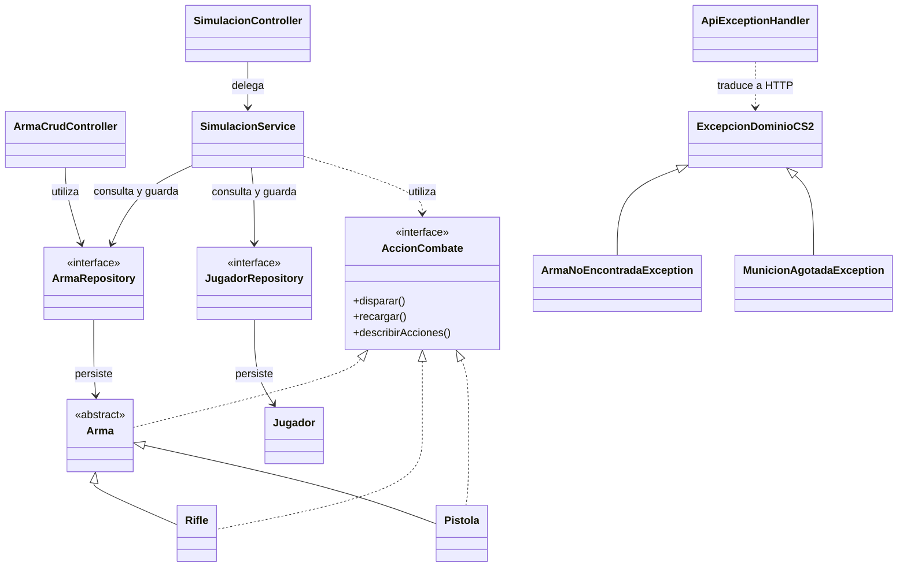

# API REST de armas de Counter-Strike 2

## Objetivo

Este proyecto implementa una API REST con Java 21 y Spring Boot para administrar armas de Counter-Strike 2, persistir su estado en H2 y ejecutar simulaciones de combate. Aplica encapsulamiento, herencia, polimorfismo, interfaces, excepciones de dominio y persistencia con Spring Data JPA.

## Tecnologías

- Java 21
- Spring Boot y Spring Web
- Spring Data JPA
- H2
- Maven
- JUnit 5
- Git y GitHub
- Insomnia
- Mermaid

## Modelo y persistencia

La familia principal está formada por `Arma`, clase padre abstracta, y sus clases hijas `Rifle` y `Pistola`. Las tres son entidades JPA y utilizan herencia `SINGLE_TABLE`: se guardan en una tabla compartida y se distinguen mediante un discriminador. `Rifle` utiliza `RIFLE` y `Pistola`, `PISTOLA`.

La clase `Jugador` también se persiste y representa al jugador que recibe daño y mantiene una reserva de munición. `ArmaRepository` administra la familia de armas y `JugadorRepository` administra los jugadores mediante Spring Data JPA.

Los identificadores son gestionados por la persistencia y se utilizan para consultar, actualizar o eliminar recursos.

## Reglas de negocio

1. **Daño y disparo (`Rifle` y `Jugador`):** durante la simulación, el rifle calcula el daño efectivo según el daño base, la distancia y la precisión, consume una bala y reduce la vida del jugador, guardando ambos estados en H2.
2. **Recarga (`Arma` y `Jugador`):** la recarga completa el cargador usando la reserva de munición del jugador y persiste ambos estados en H2, rechazando la operación si la reserva no alcanza.

Estas dos reglas se coordinan en `SimulacionService`, que realiza la operación dentro de una transacción para mantener coherentes los cambios de los recursos implicados.

## Interfaz de dominio

`AccionCombate` define operaciones de combate: disparar, recargar y describir acciones. `Arma` implementa esta interfaz, y `Rifle` y `Pistola` proporcionan el comportamiento específico de sus subtipos.

El endpoint `GET /api/simulacion/acciones/{armaId}` consulta las acciones disponibles mediante la interfaz.

## Endpoints REST

La dirección base es `http://localhost:8080`.

### CRUD de armas

| Método | Ruta | Propósito |
|---|---|---|
| POST | `/api/armas` | Crear un arma. |
| GET | `/api/armas` | Listar armas. |
| GET | `/api/armas/{id}` | Consultar un arma por ID. |
| PUT | `/api/armas/{id}` | Actualizar un arma existente. |
| DELETE | `/api/armas/{id}` | Eliminar un arma. |

Ejemplo de cuerpo para crear un rifle:

```json
{
  "tipo": "rifle",
  "nombre": "AK-47 SIMULACION",
  "precio": 2700,
  "dano": 36,
  "cargador": 30
}
```

La API valida los datos recibidos. Por ejemplo, rechaza nombres vacíos, valores negativos, cargadores inválidos, tipos no admitidos y datos numéricos incorrectos.

Respuestas principales del CRUD: creación exitosa, HTTP 201; consulta exitosa, HTTP 200; eliminación exitosa, HTTP 204; arma inexistente, HTTP 404; datos inválidos, HTTP 400.

### Jugadores y simulación

| Método | Ruta | Propósito |
|---|---|---|
| POST | `/api/simulacion/jugadores` | Crear un jugador persistido. |
| GET | `/api/simulacion/jugadores/{id}` | Consultar un jugador. |
| GET | `/api/simulacion/acciones/{armaId}` | Consultar las acciones del arma. |
| POST | `/api/simulacion/disparar?rifleId={id}&jugadorId={id}&distancia={valor}` | Disparar un rifle contra un jugador. |
| POST | `/api/simulacion/recargar?armaId={id}&jugadorId={id}` | Recargar usando la reserva del jugador. |
| POST | `/api/simulacion/acciones/{armaId}/recargar?jugadorId={id}` | Ejecutar la recarga a través del servicio. |

Ejemplo para crear un jugador:

```json
{
  "nombre": "Jugador prueba",
  "vida": 100,
  "municionReserva": 90
}
```

Primero se debe crear el arma y el jugador, y luego utilizar los IDs devueltos en las solicitudes de simulación. Después de disparar o recargar, se puede consultar nuevamente el estado para verificar la persistencia.

## Excepciones y respuestas HTTP

La jerarquía de excepciones contiene una clase base, `ExcepcionDominioCS2`, y dos clases específicas:

- `ArmaNoEncontradaException`: representa un arma inexistente y se traduce en HTTP 404.
- `MunicionAgotadaException`: representa una operación que no puede realizarse por falta de munición y se traduce en HTTP 409.

`ApiExceptionHandler` centraliza la traducción de excepciones a respuestas HTTP. Las excepciones generales de dominio y los argumentos inválidos se responden con HTTP 400.

## Configuración de H2

La configuración está en `src/main/resources/application.properties`.

| Propiedad | Función |
|---|---|
| `spring.datasource.url=jdbc:h2:file:./data/cs2db;DB_CLOSE_ON_EXIT=FALSE` | Guarda la base de datos en archivos dentro de `data/`. |
| `spring.datasource.driver-class-name=org.h2.Driver` | Selecciona el controlador JDBC de H2. |
| `spring.datasource.username=sa` | Define el usuario local. |
| `spring.datasource.password=` | Utiliza una contraseña vacía en esta configuración de desarrollo. |
| `spring.jpa.hibernate.ddl-auto=update` | Actualiza el esquema según las entidades. |
| `spring.jpa.show-sql=true` | Muestra las consultas SQL en los registros. |
| `spring.jpa.open-in-view=false` | Desactiva Open EntityManager in View. |
| `spring.h2.console.enabled=true` | Habilita la consola web de H2. |
| `spring.h2.console.path=/h2-console` | Define la ruta de la consola. |

Para abrir la consola, visitar `http://localhost:8080/h2-console` y utilizar la URL JDBC `jdbc:h2:file:./data/cs2db`, el usuario `sa` y la contraseña vacía. Esta configuración es para desarrollo local.

El directorio `/data/` está excluido de Git mediante `.gitignore`, porque contiene los archivos de la base de datos local.

## Sobrecarga y sobreescritura

### Sobrecarga (overloading)

La sobrecarga consiste en declarar métodos o constructores con el mismo nombre y diferentes listas de parámetros.

En `Rifle` existen los constructores `Rifle(String nombre, float precio)` y `Rifle(String nombre, float precio, int dano, int cargador)`; el primero delega en el segundo usando valores predeterminados. En `Pistola` existen también los constructores `Pistola(String nombre, float precio)` y `Pistola(String nombre, float precio, int dano, int cargador)`.

Ambas clases tienen `disparar()` y `disparar(int distancia)`: el primer método permite disparar sin especificar distancia y el segundo recibe una distancia explícita. Las listas de parámetros son diferentes, por eso se trata de sobrecarga.

Los constructores públicos de negocio validan los datos y dejan el objeto en un estado válido. Los constructores sin argumentos tienen visibilidad `protected` para permitir que JPA reconstruya las entidades sin ofrecerlos como constructores normales al cliente.

### Sobreescritura (overriding)

La clase abstracta `Arma` declara `public abstract String disparar()`. Las clases `Rifle` y `Pistola` implementan el mismo método con la misma firma y utilizan `@Override`.

Cada clase hija aporta su propia implementación: `Rifle.disparar()` delega en `disparar(100)`, mientras que `Pistola.disparar()` consume munición y devuelve el mensaje de disparo específico de la pistola.

La sobrecarga se distingue por tener diferentes listas de parámetros; la sobreescritura redefine en una clase hija un método heredado con la misma firma. Cuando una referencia de tipo `Arma` apunta a un rifle o una pistola, Java ejecuta la implementación correspondiente al objeto concreto.

## Respuestas a las preguntas de diseño

**Recurso y verbo HTTP.** El sustantivo principal de la API es el arma y la colección es `/api/armas`; `POST` crea, `GET` consulta, `PUT` actualiza y `DELETE` elimina los recursos.

**Identidad.** El campo `id` es la clave primaria y JPA lo genera con `GenerationType.IDENTITY`; el cliente omite el ID al crear y utiliza el valor devuelto para las operaciones posteriores.

**Herencia, tablas y tipo de arma.** `Arma` es abstracta y `Rifle` y `Pistola` son sus clases hijas; se utiliza `SINGLE_TABLE` para guardar la familia en una tabla compartida y distinguir los tipos mediante la columna de persistencia `tipo_arma`. Al crear un arma, el JSON incluye `tipo` con valor `rifle` o `pistola`, y el controller construye la clase concreta mediante un `switch`. En las respuestas, Jackson serializa las propiedades de la clase concreta, como `precision` en `Rifle` y `modoDisparo` en `Pistola`, que permiten reconocer el subtipo.

**Interfaz y repositorio.** `ArmaRepository` extiende `JpaRepository<Arma, Long>`, de modo que Spring Data JPA genera las operaciones comunes y el controller depende de la interfaz en vez de implementar consultas manuales. Este diseño separa la entrada HTTP de la persistencia y permite cambiar detalles de almacenamiento sin trasladar las reglas de combate al controller.

**Protocolo del dominio.** `AccionCombate` declara `disparar()`, `recargar()` y `describirAcciones()`. `Arma`, `Rifle` y `Pistola` implementan el contrato, y `GET /api/simulacion/acciones/{armaId}` utiliza una referencia de tipo `AccionCombate` para consultar las acciones disponibles.

**Ocultamiento e invariantes.** Los atributos del dominio se mantienen privados y las validaciones de construcción y los métodos de combate controlan los valores aceptados. Para comprobar que un POST ilegal no agrega datos, se consulta la colección con `GET /api/armas`, se envía un POST inválido y se vuelve a consultar para confirmar que la cantidad de armas persistidas no aumentó.

**PUT y PATCH.** La API usa PUT para actualizar un arma existente y exige `tipo`, `nombre` y `precio`; si se omiten `dano` o `cargador`, el controller usa los valores predeterminados del subtipo, por lo que no se trata de una actualización parcial como PATCH.

**DELETE.** `DELETE /api/armas/{id}` elimina físicamente el registro con `ArmaRepository.deleteById` y devuelve HTTP 204; si no existe, lanza `ArmaNoEncontradaException` y devuelve HTTP 404.

**Simulación persistida.** `SimulacionService` coordina el disparo o la recarga usando las reglas del dominio y persiste el arma y el jugador modificados; un GET posterior permite comprobar que el nuevo estado quedó guardado en H2.

**Excepciones y JSON de error.** `ExcepcionDominioCS2` es la clase base, `ArmaNoEncontradaException` representa un arma inexistente y devuelve HTTP 404, y `MunicionAgotadaException` representa la falta de munición y devuelve HTTP 409. `ApiExceptionHandler`, mediante `@RestControllerAdvice`, tiene un handler específico por cada hija y devuelve un JSON con la clave `error` y el mensaje de la excepción. Se usan excepciones no comprobadas derivadas de `RuntimeException` para interrumpir las operaciones que incumplen una regla y centralizar su traducción a HTTP.

## Diagrama de clases



## Cómo ejecutar y probar

### Requisitos

- Java 21.
- Git.
- Insomnia para ejecutar las solicitudes HTTP.

### Arrancar la aplicación

Desde la raíz del repositorio, en Windows PowerShell:

```powershell
.\mvnw.cmd spring-boot:run
```

En Linux o macOS:

```bash
./mvnw spring-boot:run
```

La aplicación queda disponible en `http://localhost:8080`. Para ejecutar las pruebas automatizadas desde otra terminal:

```powershell
.\mvnw.cmd test
```

### Importar Insomnia

1. Abrir Insomnia.
2. Seleccionar la opción para importar datos.
3. Importar `insomnia/CS2-API-2026.json` desde la raíz del repositorio.
4. Configurar el entorno con `base_url` igual a `http://localhost:8080`.
5. Crear primero el arma y el jugador, y guardar los IDs que devuelvan las respuestas para usarlos en las solicitudes siguientes.

### Orden recomendado de pruebas

1. Ejecutar `GET /` para comprobar que el servicio está disponible; si no aparece en la colección, crear una solicitud GET con la URL `http://localhost:8080/`.
2. Ejecutar `POST /api/armas` con datos válidos y guardar el ID devuelto.
3. Ejecutar `GET /api/armas` y `GET /api/armas/{id}` para confirmar que el arma creada se encuentra persistida.
4. Ejecutar `PUT /api/armas/{id}` y consultar otra vez para comprobar que el cambio se guardó.
5. Enviar un POST inválido, por ejemplo con el nombre vacío; debe responder HTTP 400 y la colección debe conservar la misma cantidad de armas.
6. Crear un jugador mediante `POST /api/simulacion/jugadores` y guardar su ID.
7. Ejecutar `GET /api/simulacion/acciones/{armaId}` para probar el endpoint que utiliza `AccionCombate`.
8. Ejecutar un disparo usando `/api/simulacion/disparar`, y consultar de nuevo el arma y el jugador para comprobar los cambios persistidos en la munición y en la vida.
9. Ejecutar una recarga usando `/api/simulacion/recargar`, y consultar de nuevo el arma y el jugador para comprobar los cambios en el cargador y en la reserva.
10. Consultar un ID inexistente mediante `GET /api/armas/999999` y comprobar HTTP 404.
11. Agotar la munición de un rifle de prueba e intentar disparar otra vez; comprobar que la respuesta es HTTP 409 y que el disparo fallido no cambia la vida ni la munición.
12. Ejecutar `DELETE /api/armas/{id}` y consultar luego el mismo ID para comprobar que ya no existe.

Las pruebas de simulación deben utilizar IDs reales y un estado del arma preparado para cada caso. La colección está versionada en `insomnia/CS2-API-2026.json`.

### Consultar la base H2

Abrir `http://localhost:8080/h2-console` y conectarse con la URL JDBC `jdbc:h2:file:./data/cs2db`, el usuario `sa` y la contraseña vacía, según la configuración local del proyecto.

Las propiedades están en `src/main/resources/application.properties` y se explican en la sección de configuración de H2 anterior. El directorio `/data/` está excluido de Git para no versionar la base local.

## Commit de entrega

Commit de implementación principal:

https://github.com/GioMonteggia/SMONTEGGIA-taller-git-2026/commit/b876d7d740df09eac41e5312a84aae77cb1b8c0d

Al entregar en Classroom, utilizar el enlace exacto del commit más reciente que incluya las correcciones finales de documentación e Insomnia.


Repositorio: https://github.com/GioMonteggia/SMONTEGGIA-taller-git-2026
